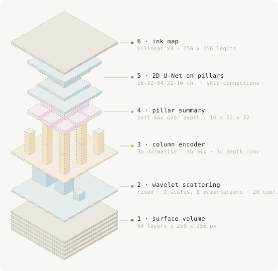
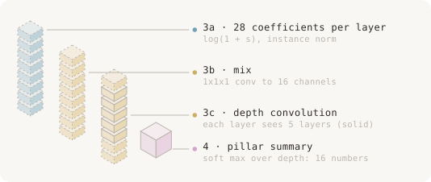

# vesuvius-X-027-pillar-reader

A 121,369-parameter ink detector for the [Vesuvius Challenge](https://scrollprize.org): fixed wavelet scattering, one feature vector per depth column ("pillar"), and a small 2D U-Net over the pillar grid.

| | |
|---|---|
| Task | ink detection on flattened surface volumes (2.5D: 3D patch in, 2D ink map out) |
| Resolution | 2.4 µm per pixel |
| Input | 64 layers × 256 × 256 px |
| Parameters | 121,369 learned (the wavelet filters are fixed) |
| F1 | 0.823 |
| Recall | 0.806 (precision 0.842) |
| Measured on | 4 held-out regions of PHerc. Paris 4, segment `w00_20231016151002`, single seed |
| Reference | villa's U-Net, same data, same patch size: F1 0.842 with 141 M parameters |

Trained weights are in [`weights/`](weights), under CC BY-NC 4.0 (the code is MIT).

## The idea

The reference model reads the surface volume with 3D convolutions all the way. This one separates the work in two:

1. **Describe each depth column with fixed mathematics.** A wavelet scattering transform turns each layer into texture coefficients that are stable to small deformations and, once averaged over orientation, do not depend on the direction of fibres or strokes. Nothing is learned here.
2. **Decide in 2D.** Each 8 × 8 px column of the volume becomes one 16-number vector (a "pillar", as in [PointPillars](https://arxiv.org/abs/1812.05784)). A small 2D U-Net then reads the grid of pillars, so each cell sees its neighbours.

Neither half works alone: the pillars without the U-Net, or the U-Net on a single score per column, stay close to the "everything is ink" baseline.

## Pipeline



Read it from bottom to top. Each stage has its own shape: sheets for the volume, three blocks for the three wavelet scales, columns for the column encoder, a low grid for the pillars, a pyramid for the U-Net.

| # | Stage | Operation | Output shape (batch omitted) | Learned parameters |
|---|---|---|---|---|
| 1 | Surface volume | input patch | 1 × 64 × 256 × 256 | — |
| 2 | Wavelet scattering | Morlet wavelets, J = 3 scales, L = 8 orientations, orders 0–2, per layer, averaged over absolute orientation | 28 × 64 × 32 × 32 | 0 |
| 3a | Compression and normalisation | log(1 + s), InstanceNorm3d (affine) | 28 × 64 × 32 × 32 | 56 |
| 3b | Mix | 1 × 1 × 1 convolution, LeakyReLU | 16 × 64 × 32 × 32 | 464 |
| 3c | Depth convolution | 5 × 1 × 1 convolution, LeakyReLU | 16 × 64 × 32 × 32 | 1,296 |
| 4 | Pillar summary | soft maximum over depth, per channel | 16 × 32 × 32 | 0 |
| 5 | 2D U-Net | 3 levels (16, 32, 64 channels), 3 × 3 convolutions, InstanceNorm2d, LeakyReLU, max-pooling, transposed convolutions, skip connections | 16 × 32 × 32 | 119,536 |
| 6 | Head and upsampling | 1 × 1 convolution, bilinear × 8 | 1 × 256 × 256 (logits) | 17 |

### One column, stages 3 and 4



The same numbers as above. One 8 × 8 px column is followed from left to right: its 28 coefficients per layer (3a), their mix into 16 channels (3b), the depth convolution where each layer sees five layers (3c, solid outlines), and the soft maximum that leaves one 16-number vector for the whole column (4).

## Equations

**Scattering.** For one layer $x$, with Morlet wavelets $\psi_{j,\theta}$ at scale $2^j$ and orientation $\theta$, and a low-pass $\phi_J$:

$$S_0 = x * \phi_J \qquad S_1(j,\theta) = |x * \psi_{j,\theta}| * \phi_J \qquad S_2(j_1,\theta_1,j_2,\theta_2) = \big||x * \psi_{j_1,\theta_1}| * \psi_{j_2,\theta_2}\big| * \phi_J$$

with $j_1 < j_2$. The output is sampled every $2^J = 8$ px.

**Rotation averaging.** Absolute orientation is averaged out; only the angle between two patterns is kept:

$$\bar S_1(j) = \frac{1}{L}\sum_{\theta} S_1(j,\theta) \qquad \bar S_2(j_1,j_2,\Delta) = \frac{1}{L}\sum_{\theta_1} S_2(j_1,\theta_1,j_2,\theta_1+\Delta)$$

This leaves $1 + J + L\,J(J-1)/2 = 28$ coefficients per cell and per layer.

**Column encoder.** With $s$ the 28 coefficients of a cell along depth $z$:

$$u = \sigma\Big(W_z *_z\; \sigma\big(W_m\,\mathrm{IN}(\log(1+s))\big)\Big)$$

where $W_m$ mixes the 28 coefficients into 16 channels, $W_z$ is a 5-tap convolution along depth, and $\sigma$ is LeakyReLU(0.01).

**Pillar summary.** Each channel $c$ is reduced over depth by a soft maximum ($\tau = 1$):

$$p_c = \tau \log \sum_{z} \exp\big(u_c(z)/\tau\big)$$

**Decision.** A 2D U-Net $f$ reads the pillar grid and its logits are upsampled: $\hat y = \mathrm{up}_{\times 8}\big(f(p)\big)$.

## Use

The model plugs into the ink-detection pipeline of [ScrollPrize/villa](https://github.com/ScrollPrize/villa), which provides data loading, augmentation, loss, optimiser and inference. Only the model is replaced.

```bash
git clone https://github.com/ScrollPrize/villa.git
git clone https://github.com/Kanemonium/vesuvius-X-027-pillar-reader.git
cd villa/vesuvius
export PYTHONPATH=../../vesuvius-X-027-pillar-reader
RUN="uv run --extra models --with kymatio==0.3.0 --with scipy==1.14.1 python -m pillar_reader.villa"
```

Train (edit `segments_path` in the config first; the data is the tutorial segment of the [ink detection tutorial](https://scrollprize.org/tutorial5)):

```bash
$RUN train ../../vesuvius-X-027-pillar-reader/configs/pillar_reader_256.json
```

Predict with the released weights (0.5 MB, the checkpoint behind the numbers above):

```bash
$RUN infer /path/to/segment.zarr ../../vesuvius-X-027-pillar-reader/weights/pillar_reader_256_step17000.pth prediction.tif --no-compile
```

The weights file holds the model, its training config and the step number; the optimiser state is not included. Loading it runs Python pickle, as with any `.pth` file.

Tested with villa at commit `0bddf27`, PyTorch 2.12, Kymatio 0.3.0 (which needs SciPy < 1.15).

## Training recipe

| | |
|---|---|
| Data | PHerc. Paris 4, segment `w00_20231016151002` (2.4 µm), labels of the tutorial |
| Held-out split | 4 of 15 labelled regions, chosen by `make_validation_mask.py` of [khj1222/vesuvius-challenge](https://github.com/khj1222/vesuvius-challenge) |
| Loss | Dice (weight 0.25) + binary cross-entropy (weight 1.0), villa defaults |
| Optimiser | SGD, learning rate 0.01, villa's default schedule |
| Precision | bf16 mixed precision (the scattering transform stays in float32) |
| Batch, steps | 2 patches of 64 × 256 × 256, 20,000 steps |
| Hardware | one RTX 5080 (16 GB) |
| Checkpoint scored | step 17,000, the best of the last four on the held-out regions |

## Known limits

- Does not transfer: trained on PHerc. Paris 4 only, it scores at the "everything is ink" baseline on PHerc. 814 and well below villa on PHerc. 841.
- Patch size matters more than anything else: the same model trained on 128 px patches reaches F1 0.56.
- Single seed. Seed-to-seed spread on this setup is about 0.012 F1.
- The best checkpoint was picked among four on the held-out regions themselves: the F1 is slightly optimistic.
- Output is blocky at 8 px (one decision per pillar, bilinear upsampling). Strokes are blurrier than villa's.
- Recall is the gap to villa: 0.806 against 0.844.
- The scattering transform is the slowest stage and runs in float32.
- An ink map is not a reading. Only papyrologists validate text.

## Credits

- [ScrollPrize/villa](https://github.com/ScrollPrize/villa) (MIT): training and inference pipeline, data, labels.
- [Kymatio](https://github.com/kymatio/kymatio) (BSD-3-Clause): the scattering transform. Andreux et al., *Kymatio: Scattering Transforms in Python*, JMLR 2020.
- Bruna and Mallat, [*Invariant Scattering Convolution Networks*](https://arxiv.org/abs/1203.1513), 2013: the transform.
- Lang et al., [*PointPillars*](https://arxiv.org/abs/1812.05784), 2019: the pillar encoding.
- [khj1222/vesuvius-challenge](https://github.com/khj1222/vesuvius-challenge) (MIT), by Hyojun Kwon: the held-out split and the evaluation harness.
- Scroll data: Vesuvius Challenge, CC BY-NC 4.0 with additional terms. No scroll data and no ink image is distributed here.

## License

- Code: [MIT](LICENSE).
- Weights: [CC BY-NC 4.0](WEIGHTS-LICENSE.md), the license of the scroll data they are trained on.
